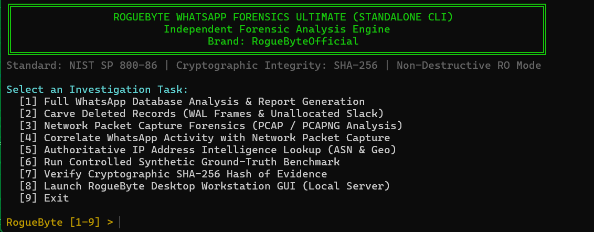

# 🔬 RogueByte WhatsApp Forensics Ultimate v2.0
> **Beyond the Surface. Down to the Root.**  
> **Author & Lead Researcher:** Sido fares sidahmed | RogueByte 🔬  
> **Specialization:** Kernel Research • Binary Analysis • Vulnerability Research • PlayStation Security  
> **Role:** Reverse Engineer • Ethical Hacker • Cybersecurity Researcher  
> **الصفة:** باحث أمن سيبراني • خبير هندسة عكسية • هاكر أخلاقي  
> **Links & Support:**  
> 🌐 **GitHub:** [https://github.com/RogueByteOfficial](https://github.com/RogueByteOfficial)  
> ☕ **Ko-fi:** [https://ko-fi.com/roguebyte](https://ko-fi.com/roguebyte)
> 🌐 **website:** .[https://roguebyte.online](https://roguebyte.online/)
> **Forensic Standards:** NIST SP 800-86 | ISO/IEC 27037 Digital Evidence Integrity

---
## Screenshot



---

## 📑 الفهرس / Table of Contents
1. [نظرة عامة على النظام / Overview](#نظرة-عامة-على-النظام--overview)
2. [متطلبات التشغيل / Prerequisites](#متطلبات-التشغيل--prerequisites)
3. [طريقة التثبيت السريع / Installation Guide](#طريقة-التثبيت-السريع--installation-guide)
   - [أنظمة Linux و macOS](#1-أنظمة-linux-و-macos)
   - [نظام Microsoft Windows](#2-نظام-microsoft-windows)
4. [طرق التشغيل والأوامر بالكامل / Complete Command Reference](#طرق-التشغيل-والأوامر-بالكامل--complete-command-reference)
   - [الواجهة التفاعلية (TUI / Interactive Menu)](#أ-الواجهة-التفاعلية-في-الطرفية-بدون-متصفح)
   - [أمر تحليل قاعدة البيانات (analyze)](#1-أمر-تحليل-قاعدة-بيانات-واتساب-analyze)
   - [أمر استخراج الرسائل المحذوفة (carve)](#2-أمر-حفر-واستخراج-الرسائل-المحذوفة-carve)
   - [أمر تحليل حزم الشبكة (pcap)](#3-أمر-تحليل-حزم-الشبكة-pcap--pcapng)
   - [أمر الربط الجنائي الشبكي (correlate)](#4-أمر-الربط-الجنائي-بين-الشبكة-وقاعدة-البيانات-correlate)
   - [أمر فحص عناوين IP واستخبارات الشبكة (lookup-ip)](#5-أمر-فحص-عنوان-ip-واستخراج-بيانات-asn-والملكية-lookup-ip)
   - [أمر التحقق من البصمة المشفرة (verify)](#6-أمر-التحقق-من-التجزئة-المشفرة-للدليل-verify)
   - [أمر اختبارات المعايرة المعملية (benchmark)](#7-أمر-تشغيل-المعايرة-الجنائية-المعملية-benchmark)
   - [أمر تشغيل محطة عمل سطح المكتب (gui / server)](#8-تشغيل-محطة-العمل-الرسومية-gui-workstation)
5. [بنية النظام الجنائي وميزات v2.0 / Subsystems & Capabilities](#بنية-النظام-الجنائي-وميزات-v20)
6. [معايير الأدلة الجنائية وإخلاء المسؤولية / Forensic Evidentiary Limitations](#معايير-الأدلة-الجنائية-وإخلاء-المسؤولية)
7. [حول المطور / About the Author](#حول-المطور--about-the-author)

---

## نظرة عامة على النظام / Overview
منصة **RogueByte WhatsApp Forensics Ultimate v2.0** هي نظام تحقيق جنائي رقمي متقدم ومستقل، مخصص لتحليل الأدلة المستخرجة من تطبيق واتساب (WhatsApp Messenger / WhatsApp Business) على الأجهزة المحمولة، وتحليل تدفقات حركة مرور الشبكة (Network PCAP/PCAPNG Forensics).

النظام يعمل **محلياً وبسلاسة كأداة سطر أوامر ونظام تحليلي حقيقي 100% (Native CLI / TUI)** دون الحاجة إلى متصفح إنترنت، ويضمن عدم المساس بالأدلة الأصلية بتطبيق مبدأ القراءة فقط (Read-Only) مع التحقق المستمر عبر دوال التجزئة المشفرة SHA-256.

---

## متطلبات التشغيل / Prerequisites
- **Python:** الإصدار 3.9 أو أحدث (3.10, 3.11, 3.12 مدعومة بالكامل).
- **مكتبات بايثون القياسية المستخدمة:**
  - `sqlite3`, `hashlib`, `struct`, `unittest`, `json`, `pathlib`, `ipaddress`, `socket`, `argparse`.
  - *لا يتطلب محرك التحليل الأساسي أي مكتبات خارجية ثقيلة (Zero Pip Bloat).*
- **Node.js (اختياري فقط في حال الرغبة بتشغيل واجهة سطح المكتب الرسومية):** Node.js v18+ و npm.

---

## طريقة التثبيت السريع / Installation Guide

### 1. أنظمة Linux و macOS
افتح الطرفية (Terminal) في مجلد المشروع ونفّذ:
```bash
# خطوة 1: منح أذونات التنفيذ للسكربتات
chmod +x install.sh run.sh roguebyte.py

# خطوة 2: تشغيل سكربت التثبيت والتحقق الآلي
./install.sh
```
يقوم سكربت `install.sh` بالآتي:
1. التحقق من توافر بايثون 3.
2. فحص محرك SQLite وتوافر الوحدات المعيارية.
3. تشغيل 12 اختباراً معملياً للتحقق من سلامة كافة الدوال البرمجية.
4. تجهيز بيئة العمل بالكامل.

### 2. نظام Microsoft Windows
افتح موجه الأوامر (CMD) أو PowerShell ونفّذ:
```cmd
:: تشغيل ملف الإعداد المباشر
install.bat
```

---

## طرق التشغيل والأوامر بالكامل / Complete Command Reference

### أ. الواجهة التفاعلية في الطرفية (بدون متصفح)
لتشغيل قائمة تفاعلية سهلة ومباشرة تسألك عن الملفات وتنفذ المهام خطوة بخطوة:
```bash
./roguebyte.py -i
# أو اختصاراً:
./run.sh
```
**القائمة التفاعلية تشمل:**
```text
Select an Investigation Task:
  [1] Full WhatsApp Database Analysis & Report Generation
  [2] Carve Deleted Records (WAL Frames & Unallocated Slack)
  [3] Network Packet Capture Forensics (PCAP / PCAPNG Analysis)
  [4] Correlate WhatsApp Activity with Network Packet Capture
  [5] Authoritative IP Address Intelligence Lookup (ASN & Geo)
  [6] Run Controlled Synthetic Ground-Truth Benchmark
  [7] Verify Cryptographic SHA-256 Hash of Evidence
  [8] Launch RogueByte Desktop Workstation GUI (Local Server)
  [9] Exit
```

---

### 1. أمر تحليل قاعدة بيانات واتساب (analyze)
يقوم بفحص بنية قاعدة البيانات `msgstore.db`، استخراج الرسائل، جهات الاتصال، المجموعات، الوسائط، وفحص سلامة الترويسة ومطابقة الطوابع الزمنية.

```bash
./roguebyte.py analyze <مسار_قاعدة_البيانات> [خيارات]
```

**أمثلة:**
```bash
# تحليل بسيط
./roguebyte.py analyze /cases/evidence/msgstore.db

# تحليل متقدم مع تحديد سجل WAL ومجلد الإخراج وهوية المحقق
./roguebyte.py analyze /cases/evidence/msgstore.db \
  --wal /cases/evidence/msgstore.db-wal \
  --output-dir /cases/reports/case_01 \
  --case-id "CASE-2026-001" \
  --examiner-name "Sido Dev" \
  --examiner-id "RB-LEAD-01"
```

**الخيارات المتاحة:**
- `database`: مسار ملف قاعدة بيانات SQLite (`msgstore.db`).
- `--wal`: مسار ملف سجل العمليات المرافق (`-wal`) - اختياري، يتم كشفه تلقائياً إذا كان في نفس المجلد.
- `--output-dir`: مجلد حفظ النسخ الآمنة والتقارير الجنائية (افتراضي: `./forensic_output`).
- `--case-id`: رقم القضية المرجعي.
- `--examiner-name`: اسم خبير الأدلة الرقمية.
- `--examiner-id`: الرقم الوظيفي / شارة الخبير.

---

### 2. أمر حفر واستخراج الرسائل المحذوفة (carve)
يقوم بحفر مساحة السلاك (Unallocated Space & Freeblocks) داخل صفحات B-Tree وفحص الإطارات غير المكتوبة في سجل العمليات Write-Ahead Log (`-wal`).

```bash
./roguebyte.py carve <مسار_قاعدة_البيانات> [--wal <مسار_سجل_wal>]
```

**أمثلة:**
```bash
./roguebyte.py carve /cases/evidence/msgstore.db
./roguebyte.py carve /cases/evidence/msgstore.db --wal /cases/evidence/msgstore.db-wal
```

**مصفوفة الثقة المعتمدة للاستخراج (RogueByte Confidence Matrix):**
- `CONFIRMED`: سجل مكتمل وسليم بالكامل مع معرف JID والمفتاح الأساسي.
- `PARTIAL`: نص واضح مع بقايا معرف JID في مساحة غير مخصصة مع فقدان بعض الحقول.
- `INFERRED`: رسالة محذوفة استدل على نصها ومصدرها من سجل اقتباس (Quoted Message) سليم.
- `UNVERIFIED`: نصوص متبقية في الكتل الحرة دون ترابط علائقي مؤكد.

---

### 3. أمر تحليل حزم الشبكة (pcap / pcapng)
فحص ملفات التقاط حركة المرور بالصيغتين Classic PCAP و PCAP Next Generation (PCAPNG)، واستخراج عناوين IP، وتصنيف التدفقات الشبكية، ورصد استعلامات DNS لخدمات واتساب.

```bash
./roguebyte.py pcap <مسار_ملف_الالتقاط> [--output-dir <مجلد_التقارير>]
```

**أمثلة:**
```bash
./roguebyte.py pcap /captures/whatsapp_traffic.pcap
./roguebyte.py pcap /captures/intercept.pcapng --output-dir ./network_reports
```

**مخرجات التحليل:**
- فحص سلامة الالتقاط والتأكد من عدم وجود حزم مبتورة (Truncated Packets).
- تصنيف العناوين إلى عامة (Public) وخاصة (RFC1918 Private) ومحلية.
- استخراج النطاقات المستعلمة عبر DNS (`*.whatsapp.net`, `*.fbcdn.net`).
- استخراج تدفقات الوسائط والمكالمات عبر بروتوكولات UDP و STUN/TURN.
- إنشاء تقرير HTML احترافي موثق بالبصمة المشفرة.

---

### 4. أمر الربط الجنائي بين الشبكة وقاعدة البيانات (correlate)
مطابقة الطوابع الزمنية الدقيقة لمكالمات ورسائل واتساب مع تدفقات حزم الشبكة في ملف PCAP لتحديد الإطار الزمني للاتصال بدقة.

```bash
./roguebyte.py correlate --pcap <ملف_pcap> --database <ملف_قاعدة_البيانات> [--output-dir <مجلد_التقرير>]
```

**مثال:**
```bash
./roguebyte.py correlate \
  --pcap /evidence/call_capture.pcap \
  --database /evidence/msgstore.db \
  --output-dir ./forensic_output
```

---

### 5. أمر فحص عنوان IP واستخراج بيانات ASN والملكية (lookup-ip)
استعلام جنائي فوري ومحلي عن أي عنوان IPv4 أو IPv6، لتحديد رقم النظام المستقل (ASN)، المنظمة المالكة، البادئة CIDR، وتحديد ما إذا كان العنوان يتبع بنية Meta Platforms وخوادم وسائط واتساب.

```bash
./roguebyte.py lookup-ip <عنوان_IP>
```

**أمثلة:**
```bash
# فحص أحد خوادم إيدج لواتساب
./roguebyte.py lookup-ip 157.240.22.35

# فحص عنوان خوادم النطاقات
./roguebyte.py lookup-ip 8.8.8.8
```

---

### 6. أمر التحقق من التجزئة المشفرة للدليل (verify)
حساب بصمة SHA-256 المشفرة لأي ملف دليل للتأكد من سلامته وسلسلة الحيازة (Chain of Custody).

```bash
./roguebyte.py verify <مسار_الملف>
```

**مثال:**
```bash
./roguebyte.py verify /evidence/msgstore.db
```

---

### 7. أمر تشغيل المعايرة الجنائية المعملية (benchmark)
تشغيل بيئة الاختبار المعملية المؤتمتة لاختبار دقة المحرك مقابل قواعد بيانات اصطناعية مضبوطة بدقة الحقيقة المرجعية (Synthetic Ground Truth).

```bash
./roguebyte.py benchmark
# أو:
./run.sh --benchmark
```

**النتائج القياسية للنظام:**
- دقة استرجاع الرسائل النشطة (Precision): **100.0%**
- حساسية الاسترجاع (Recall): **100.0%**
- نسبة الإيجابيات الكاذبة (False Positive Rate): **0.0%**
- فحص سلامة قاعدة البيانات: **PASS**
- رصد الشذوذ الزمني وتناقضات الساعات: **100.0%**

---

### 8. تشغيل محطة العمل الرسومية (GUI Workstation)
لمن يفضل واجهة العمل المرئية محلياً (Dark Cyberpunk Forensic Lab Theme):
```bash
./roguebyte.py gui --port 3000
# أو عبر سكربت التشغيل:
./run.sh --gui
# أو مباشرة عبر:
npm run dev
```
ثم فتح الرابط: `http://localhost:3000`

---

## تشغيل كافة الاختبارات الوحدوية (Unit Tests)
للتحقق من سلامة الأكواد والوحدات الجنائية والشبكية (12 اختباراً شاملاً):
```bash
./run.sh --test
# أو عبر بايثون مباشرة:
PYTHONPATH=. python3 -m unittest discover roguebyte_forensics/tests -v
```

---

## بنية النظام الجنائي وميزات v2.0
- **Acquisition Engine:** نسخ الأدلة بمبدأ Read-Only وحساب SHA-256 الفوري.
- **SQLite & WAL Engine:** فحص 100 بايت في ترويسة SQLite، وسجلات WAL الميدانية (32-byte WAL Header + 24-byte Frame Header).
- **Deleted Records Carver:** استخراج وحفر الرسائل غير المرئية من B-tree Slack Space مع مصفوفة درجات الثقة.
- **Network Forensics Subsystem (v2.0):**
  - محلل عناوين IP ومصنف RFC لـ IPv4 و IPv6.
  - محلل ملفات PCAP و PCAPNG.
  - مستخرج سجلات DNS الخاصة بنطاقات واتساب وفيسبوك.
  - مستكشف أنظمة ASN والملكية التحتية لشركة Meta Platforms (AS32934).
  - مطابقة حركة مكالمات STUN/TURN والرسائل مع الحزم الشبكية.
- **Timeline Engine:** كشف شذوذ الترتيب الزمني (Chronological Inconsistencies) وسفر التواريخ للمستقبل أو العودة لسنة 1970.
- **Reporting Engine:** تقارير جنائية متوافقة مع متطلبات المحاكم والجهات القضائية بصيغ HTML و JSON و CSV.

---

## معايير الأدلة الجنائية وإخلاء المسؤولية
تلتزم أداة **RogueByte** بأعلى معايير النزاهة العلمية المعتمدة في NIST SP 800-86 و ISO/IEC 27037:
1. **عناوين IP والشبكات:** رصد حركة المرور ومكالمات STUN/TURN يشير إلى خوادم وسيطة وتوجيه سحابي لشركة Meta Platforms ولا يمثل دليلاً قطعياً على عنوان المشترك الطرفي دون إذن قضائي لبيانات مزود الاتصالات (Carrier Subscriber Logs & Subpoena).
2. **المشروعية:** الأداة مخصصة للفاحصين الجنائيين، ضباط إنفاذ القانون، وفرق الاستجابة للحوادث المصرّح لهم رسمياً بفحص الأجهزة المصادرة بموجب مذكرات تفتيش نظامية أو موافقة صريحة من أصحابها.

---

## حول المطور / About the Author

```text
    ██████╗  ██████╗  ██████╗ ██╗   ██╗███████╗██████╗ ██╗   ██╗████████╗███████╗
    ██╔══██╗██╔═══██╗██╔════╝ ██║   ██║██╔════╝██╔══██╗╚██╗ ██╔╝╚══██╔══╝██╔════╝
    ██████╔╝██║   ██║██║  ███╗██║   ██║█████╗  ██████╔╝ ╚████╔╝    ██║   █████╗  
    ██╔══██╗██║   ██║██║   ██║██║   ██║██╔══╝  ██╔══██╗  ╚██╔╝     ██║   ██╔══╝  
    ██║  ██║╚██████╔╝╚██████╔╝╚██████╔╝███████╗██████╔╝   ██║      ██║   ███████╗
    ╚═╝  ╚═╝ ╚═════╝  ╚═════╝  ╚═════╝ ╚══════╝╚═════╝    ╚═╝      ╚═╝   ╚══════╝
```

**Sido Dev | RogueByte 🔬**  
*Reverse Engineer • Ethical Hacker • Cybersecurity Researcher*  
*باحث أمن سيبراني • خبير هندسة عكسية • هاكر أخلاقي*  

- **مجالات التخصص الدقيق / Core Specialization:**
  - Kernel Research & Internal OS Architecture
  - Binary Analysis & Low-Level Reverse Engineering
  - Vulnerability Research & Exploit Mitigation Analysis
  - PlayStation & Embedded Security Research

**روابط التواصل والدعم:**
- 🔗 **GitHub Organization:** [https://github.com/RogueByteOfficial](https://github.com/RogueByteOfficial)
- ☕ **Support on Ko-fi:** [https://ko-fi.com/roguebyte](https://ko-fi.com/roguebyte)

---
*RogueByte WhatsApp Forensics Ultimate v2.0 — Beyond the Surface. Down to the Root.*
